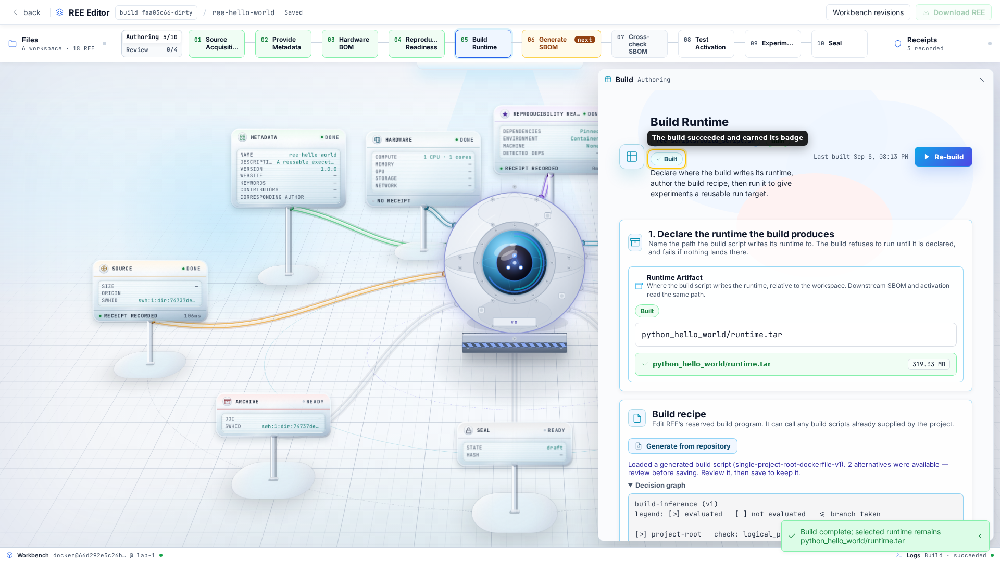

# The Runtime of an REE

The runtime is the environment in which an REE runs its experiments. The build
recipe produces it, the SBOM inventories it, and receipts bind results to it.

This guide explains the build contract, supported packages, and common sources
of long-term build failure.

## Three environments, and which one you are packaging

Building an REE involves three nested environments. Only the innermost one is
the runtime.

| | What it is | Who provides it | Does it ship? |
|---|---|---|---|
| **Workbench** | An isolated container, one per REE, where every repo2ree operation runs — acquiring source, evaluating, building, scanning, sealing. | repo2ree, from a base image; the provider injects the executor and its tools at provision time. | No. |
| **Workspace** | A directory inside that workbench (`workspace/`), materialized from the frozen source plus the REE overlay. Scripts run from its root. | repo2ree combines `upstream/` + `overlay/`. | Its declared contents do; repo2ree can reset the directory. |
| **Runtime** | The artifact your build script produces and experiments enter. | **You**, through the repository's build recipe. | Optionally. Its recipe and available evidence always do. |

The build script runs **in the workspace, not in the runtime**. It executes as a
plain subprocess from the workspace root inside the workbench, using the
workbench's tooling — notably its Docker daemon. The runtime does not exist yet
while the build script runs; producing it is the point.

Experiments are the other way around. An experiment script also starts in the
workspace, but its job is to *enter* the runtime: load the artifact, then run the
command inside it with the workspace bind-mounted, so the code and the produced
outputs live in the workspace while the environment comes from the runtime.

Three consequences explain most confusing build failures:

- **What the workbench has, the runtime does not.** `git`, `curl`, a Python
  interpreter, or the Docker CLI being available to the build script says
  nothing about the runtime. If an experiment needs a tool, the repository's
  recipe has to install it into the image.
- **Nothing you do by hand in the workbench survives.** The workbench is
  disposable and can be re-provisioned from its base image; only the REE tree
  is durable. An environment assembled by hand there is not part of the
  artifact and will not exist for anyone else. It must be in the recipe.
- **The build should touch the workspace only to write its artifact.** The build
  receipt records other changes as workspace drift. A
  build that quietly edits source is a build nobody else can repeat.

The rest of this guide is about the third row of that table.

## What repo2ree does and does not supply

repo2ree does not invent an environment for your code. It asks you for one
script — the **runtime build script** — and everything that script needs must
already be in the source repository:

| Lives in the source repository | Lives in the REE overlay |
|---|---|
| `Dockerfile`, `environment.yml`, `flake.nix`, `apptainer.def` | `ree-scripts/build_script.sh` |
| `requirements.txt`, `poetry.lock`, `uv.lock`, `renv.lock`, `Project.toml` | `ree-scripts/activation.sh` |
| `pom.xml`, `package-lock.json`, `Cargo.lock`, `Makefile` | `ree-scripts/experiments/<slug>.sh` |

That split is deliberate. The recipe for the environment belongs to the
research project and should be reviewable, versioned, and citable with it. The
overlay only says *how to invoke* that recipe and *where to leave the result*.

If the repository has no build recipe at all, write one and commit it upstream
before authoring the REE. An REE whose environment exists only inside repo2ree
is a worse artifact than one whose environment is in the repository.

### Example

The [tutorial](../tutorials/create-your-first-ree.md) uses a small pandas
project. The source tree already describes the environment before repo2ree
enters the process:

```
python_hello_world/
├── Dockerfile
├── requirements.txt
└── main.py
```

`requirements.txt` declares the dependency:

```
pandas==2.2.1
```

`Dockerfile` declares the environment and how to enter it:

```dockerfile
FROM python:3.11-slim
WORKDIR /app
COPY requirements.txt .
RUN pip install --no-cache-dir -r requirements.txt
COPY . .
CMD ["python", "main.py"]
```

The REE adds a build script that invokes the recipe and exports its result. This
is the script generated for the tutorial project when it has no runtime path:

```sh
#!/usr/bin/env sh
set -eu

DOCKERFILE='python_hello_world/Dockerfile'
BUILD_CONTEXT=python_hello_world
IMAGE_TAG=ree-runtime:ree-hello-world
RUNTIME_ARTIFACT=python_hello_world/.repo2ree/artifacts/runtime.tar

docker build \
    --file "$DOCKERFILE" \
    --tag "$IMAGE_TAG" \
    "$BUILD_CONTEXT"

mkdir -p "$(dirname "$RUNTIME_ARTIFACT")"
docker save \
    "$IMAGE_TAG" \
    --output "$RUNTIME_ARTIFACT"
```

Notice what the script does **not** do. It does not choose a base image, install
pandas, set a working directory, or know that the program is `main.py`. Every one
of those decisions lives in the repository. Researchers can version and review
them with the code. The script only:

1. names the build context — `python_hello_world`, the project root;
2. tags the image so later scripts can refer to it;
3. exports the image to a file at the path the REE declares.

Generation also proposes
`python_hello_world/.repo2ree/artifacts/runtime.tar` as the runtime declaration.
The page applies that path when the field is empty. A script that exits zero
without producing the declared file still fails the build.

The example is a starting point, not a model answer. Evaluate reports the exact
`pandas==2.2.1` pin, the floating `python:3.11-slim` tag, and the unlocked
transitive dependencies. Fix these gaps upstream by following the
[packaging rules](#packaging-rules-that-keep-a-build-reproducible).

## The build contract



The Build Runtime step in the app is that contract made concrete: you declare
where the build writes its runtime, author the recipe that puts it there, and
run it. Three things define a repo2ree runtime build:

1. **A build script path**, workspace-relative — conventionally
   `ree-scripts/build_script.sh`.
2. **A runtime artifact path** (`runtime_path`), workspace-relative — where the
   build must leave its output as a file, e.g. `.repo2ree/artifacts/runtime.tar`
   (see [The runtime is a file](#the-runtime-is-a-file-not-a-running-thing)).
3. **A zero exit code**, plus the artifact actually existing afterwards.

Execution details you can rely on:

- the script runs as `sh <path>` **from the workspace root**, so every path in
  it is workspace-relative unless it `cd`s first;
- **repo2ree injects no environment** — no REE id, output directory, or secrets.
  If your build needs a value, it must come from the repository or be a literal
  in the script;
- the workbench *is* the isolation boundary, so the script runs as a plain
  subprocess inside it rather than in a container of its own, with the
  workbench's Docker daemon available to it;
- the definition records a digest of the build script. Editing
  the script invalidates the recorded build and requires a rebuild;
- if the script exits 0 but `runtime_path` does not exist, the build fails. A
  build that "succeeded" without producing an artifact is not a build.

The example above is a complete build script under this contract. If the
artifact path sits in a directory the repository does not already have, create it
first — `mkdir -p "$(dirname "$RUNTIME_ARTIFACT")"` before the export — since a
missing parent directory is the usual reason a `docker save` fails at the end of
an otherwise successful build.

repo2ree can propose a script when it finds one Dockerfile at the logical
project root or a plain `requirements.txt` project. Generation loads the script
into the editor but does not save or run it. Review it, then save it if it fits
the project.

## The runtime is a file, not a running thing

repo2ree does not accept "the image is on my machine" or "pull it from our
registry" as a runtime. The build script must leave a **file** at
`runtime_path`, and that file is what everything downstream reads: the digest on
the receipt, the SBOM scan, the activation script that loads it back, and — if
you choose to include it — the sealed bundle.

That means every packaging technology needs an export step at the end of the
build:

| Technology | Export step | First-class downstream support |
|---|---|---|
| Docker | `docker save "$IMAGE_TAG" --output runtime.tar` | Build generation, activation and experiment scaffolds, SBOM, and review |
| Python venv | `tar czf runtime-venv.tar.gz -C /opt venv` | Build generation, activation and experiment scaffolds; no SBOM |
| Podman or Buildah | Export a Docker archive | Same downstream Docker-archive support; scripts require the chosen tool |
| Nix | Build a Docker image tar | Same downstream Docker-archive support |
| Apptainer, Conda, or a rootfs | Export one file | Custom scripts only; no generated scaffold or runtime SBOM |

Worked recipes for Docker, Podman, Apptainer, and Nix are
[below](#recipes-by-technology). Prefer a Docker image tar unless the project
requires another format. It has the complete generation, SBOM, and review path.

## What ships, and what the artifact adds

The runtime artifact does **not** have to travel inside the sealed REE, and
often it should not. What always travels is everything needed to build it again
and to check that the result is the same environment:

- the **build recipe** — the repository's `Dockerfile` or equivalent in the
  frozen source snapshot, plus the build script in the overlay;
- the **SBOM** — the inventory of what the runtime contained, which provides a
  comparison point for a future rebuild;
- the **receipts** — the build script's digest, the artifact's digest, and the
  runs that used it.

That combination is the certificate. Someone rebuilding in three years does not
have to trust a claim that the environment was right: they rebuild from the
recipe, scan their own result, and reconcile it against the recorded SBOM and
digests. Where the environment has drifted, the reconciliation names the package
that moved instead of leaving them to guess.

**Packaging the artifact turns "should rebuild" into "runs as-is".** Because the
build produces a file rather than a daemon-resident image, the REE *can* carry
that file beside the source snapshot and the receipts — the difference between
the Cite and Replay archive tiers. What that buys:

- **No third-party service on the critical path.** A registry reference is a
  promise by someone else to keep hosting something. Registries delete untouched
  tags, change retention policy, rename organizations, rate-limit anonymous
  pulls, and go away. A bundled tar depends on nobody.
- **No rebuild risk at all.** A recipe can stop building — a base image
  disappears, an index drops an old version, a build tool changes behaviour. A
  bundled artifact still runs.
- **Offline inspection.** Anyone auditing the environment later reads the file
  directly: no daemon, no network, no credentials.
- **Deposit-friendliness.** Software Heritage, Zenodo, and Dataverse take
  deposits, not registry coordinates. What sits in the bundle is what survives.

The cost is size. A multi-gigabyte image makes every later step — scan, seal,
download, deposit — slower, and may exceed what an archive accepts. Treat it as
a judgement call: seal the artifact when the runtime is small enough or the
result matters enough to guarantee, and rely on the recipe and SBOM when it is
not. Either way, produce the file — the SBOM and the digest evidence depend on
it existing, whether or not it ends up in the bundle.

## Choosing a packaging technology

Any environment that a build can export to a file is a candidate. These are the
practical choices, ordered by current support:

**Docker image, exported with `docker save`.** This is the best-supported path.
The SBOM step scans Docker archives, and generated run scripts know how to load
them. Review first compares the artifact digest, then the SBOM closure when the
bytes differ.

**A packed Python virtualenv** (`.tar.gz` of a venv). The docker-less path for
plain `requirements.txt` projects. The generated build packs a venv, and each
generated runnable restores it. This is fast but inherits the workbench's
interpreter and system libraries. The SBOM scanner cannot scan the packed venv.
The generated scripts build it outside the workspace and restore it to the same
absolute path because virtual environments contain absolute paths.

**Podman.** A drop-in alternative that reads the same recipe file and exports
the same archive format, so nothing downstream can tell the difference.

**Nix, Guix, Conda / mamba, Spack.** Best used to *produce* an image tar — Nix's
`dockerTools`, a conda environment inside a Dockerfile — so you keep the
evidence chain while gaining the stronger pinning. Nix and Guix give by far the
strongest reproducibility story; Conda gives the weakest unless you commit a
fully solved lock file (`conda-lock`), because `environment.yml` re-solves
differently on every machine and date.

**Apptainer / Singularity.** A `.sif` can be the right artifact for HPC. It has
no generated run scaffolds or SBOM support. Each recipient also needs
Apptainer. See the recipe below before choosing it.

**Not runtimes:** a `setup.sh` that installs into the host, a README that says
"install PyTorch", or an environment that exists only on your cluster.

### Recipes by technology

Each pair below shows the same split as the example above: the recipe file that
belongs in the **source repository**, and the build script the **REE** adds to
invoke it and export the result.

One constraint applies to all of them. The build script can only use tools the
workbench actually has, and the stock workbench is Docker-based — see
[Three environments](#three-environments-and-which-one-you-are-packaging). The
Apptainer and Nix examples run their toolchains *through* a container. If your
deployment provides a
workbench image that already carries the tool, call it directly instead.

#### Docker

In the repository — `Dockerfile`:

```dockerfile
FROM python:3.11-slim@sha256:1234…
WORKDIR /app
COPY requirements.lock .
RUN pip install --no-cache-dir --require-hashes -r requirements.lock
COPY . .
CMD ["python", "main.py"]
```

In the REE — `ree-scripts/build_script.sh`:

```sh
#!/usr/bin/env sh
set -eu

PROJECT_DIR="myproject"
IMAGE_TAG="ree-runtime:my-paper"
RUNTIME_ARTIFACT="$PROJECT_DIR/runtime.tar"

docker build --platform linux/amd64 --tag "$IMAGE_TAG" "$PROJECT_DIR"
docker save "$IMAGE_TAG" --output "$RUNTIME_ARTIFACT"
```

Declare `myproject/runtime.tar` as the runtime artifact. This is the path with
the fewest surprises: the SBOM step scans it directly and the bundle's `run.sh`
loads it on any Docker host.

#### Podman

Podman reads the same file, conventionally named `Containerfile` (a `Dockerfile`
works unchanged). In the repository — `Containerfile`:

```dockerfile
FROM docker.io/library/python:3.11-slim@sha256:1234…
WORKDIR /app
COPY requirements.lock .
RUN pip install --no-cache-dir --require-hashes -r requirements.lock
COPY . .
CMD ["python", "main.py"]
```

In the REE — `ree-scripts/build_script.sh`:

```sh
#!/usr/bin/env sh
set -eu

PROJECT_DIR="myproject"
IMAGE_TAG="ree-runtime:my-paper"
RUNTIME_ARTIFACT="$PROJECT_DIR/runtime.tar"

podman build --platform linux/amd64 --tag "$IMAGE_TAG" "$PROJECT_DIR"

# --format docker-archive matters: podman's default export is an OCI archive,
# which the SBOM scanner and `docker load` do not read.
podman save --format docker-archive --output "$RUNTIME_ARTIFACT" "$IMAGE_TAG"
```

The exported tar is interchangeable with the one Docker produces, so
everything downstream —
SBOM, activation, `run.sh` on a recipient's machine — behaves identically. Note
that Podman resolves bare image names against its own registry list, so spell
base images fully (`docker.io/library/…`).

#### Apptainer (Singularity)

The HPC-facing option: a single `.sif` file, no daemon, and it runs unprivileged
on clusters that will not give you Docker.

In the repository — `apptainer.def`:

```
Bootstrap: docker
From: python:3.11-slim@sha256:1234…

%files
    requirements.lock /opt/requirements.lock
    main.py /opt/app/main.py

%post
    pip install --no-cache-dir --require-hashes -r /opt/requirements.lock

%runscript
    exec python /opt/app/main.py "$@"
```

In the REE — `ree-scripts/build_script.sh`:

```sh
#!/usr/bin/env sh
set -eu

PROJECT_DIR="myproject"
RUNTIME_ARTIFACT="$PROJECT_DIR/runtime.sif"
APPTAINER_IMAGE="quay.io/apptainer/apptainer:1.3.6"

# Apptainer is not in the stock workbench, so run it from a container. It needs
# --privileged to build, which the workbench's own daemon provides.
docker run --rm --privileged \
    -v "$(pwd)/$PROJECT_DIR:/work" -w /work \
    "$APPTAINER_IMAGE" \
    build --force runtime.sif apptainer.def
```

Two consequences to accept before choosing this: the SBOM step cannot scan a
`.sif` (it reads `docker-archive` tarballs), so the runtime inventory has to
come from elsewhere, and every recipient — including `run.sh` from the sealed
bundle — needs Apptainer installed. The activation and experiment scripts change
shape accordingly, running `apptainer exec runtime.sif …` instead of a
`docker load` / `docker run` pair.

If you want the SIF *and* the evidence, build a Docker image as the runtime
artifact and generate the SIF from it as a separate convenience output.

#### Nix

The strongest reproducibility story of the four: the flake lock pins the entire
dependency closure, down to the C libraries, by hash.

In the repository — `flake.nix` (with its `flake.lock` committed beside it):

```nix
{
  inputs.nixpkgs.url = "github:NixOS/nixpkgs/nixos-24.11";

  outputs = { self, nixpkgs }:
    let
      system = "x86_64-linux";
      pkgs = import nixpkgs { inherit system; };
      python = pkgs.python311.withPackages (ps: [ ps.pandas ]);
    in {
      packages.${system}.runtimeImage = pkgs.dockerTools.buildLayeredImage {
        name = "ree-runtime";
        tag = "latest";
        contents = [ python pkgs.bashInteractive pkgs.coreutils ];
        config = {
          WorkingDir = "/app";
          Cmd = [ "${python}/bin/python" "/app/main.py" ];
        };
      };
    };
}
```

In the REE — `ree-scripts/build_script.sh`:

```sh
#!/usr/bin/env sh
set -eu

PROJECT_DIR="myproject"
RUNTIME_ARTIFACT="$PROJECT_DIR/runtime.tar.gz"
NIX_IMAGE="docker.io/nixos/nix:2.24.9"

# Nix is not in the stock workbench either. The container writes `result` as a
# symlink into its own store, so dereference it on the way out with `cp -L`.
docker run --rm \
    -v "$(pwd)/$PROJECT_DIR:/work" -w /work \
    "$NIX_IMAGE" \
    sh -c 'nix --extra-experimental-features "nix-command flakes" \
             build .#runtimeImage && cp -L result /work/runtime.tar.gz'

test -f "$RUNTIME_ARTIFACT"
```

`dockerTools.buildLayeredImage` emits a gzip-compressed Docker image tarball.
Declare `myproject/runtime.tar.gz` as the runtime artifact. The SBOM scanner
accepts the suffix because the contents are still a Docker archive.

Two things make this worth the extra machinery. `flake.lock` pins the build
instead of accepting whatever the package index serves. The image construction
also omits timestamps, which makes matching rebuild digests more likely.

## Packaging rules that keep a build reproducible

These are the rules that decide whether the artifact still builds in three
years.

**Pin the base image by digest, never by a moving tag.** `FROM python:3.11`
means a different environment every month; `FROM python:3.11-slim@sha256:…`
means one environment forever. Keep the tag beside the digest as a comment for
humans — the digest is what binds.

**Pin dependencies with a lock file, and copy the lock file, not the loose
list.** `pip install -r requirements.txt` with unpinned ranges, `npm install`
without `package-lock.json`, or `cargo install` without `Cargo.lock` all resolve
against the index at build time. Use `pip install -r requirements.lock`
(from `pip-compile`/`uv pip compile`), `npm ci`, `poetry install --no-root`,
`renv::restore()`, `--frozen-lockfile`.

**Pin system packages too, or accept that you have not.** `apt-get install -y
libgdal-dev` is a floating dependency exactly like an unpinned Python package.
Pin versions (`libgdal-dev=3.6.2+dfsg-1+b2`) where the distribution archive
makes it possible. When it matters, prefer a distribution that preserves its
archive, such as Debian through snapshot.debian.org.

**Fetch nothing at run time.** Every download that happens when the experiment
runs — model weights, reference data, a `git clone`, a `pip install` in an
entrypoint — is a future failure and an unrecorded dependency. Fetch during the
build, verify a checksum, and bake it in. If the data is too large to bake in,
declare it as an input and document its retrieval separately; do not hide it in
a run command.

**Build for a named platform.** An image built on an Apple-silicon laptop is
`linux/arm64` and will not run on an `linux/amd64` reviewer machine without
emulation. Pass `--platform linux/amd64` explicitly, and say so, rather than
letting the host decide.

**Keep results out of the image.** The runtime is the environment; outputs
belong in the workspace, which is bind-mounted into the container when
experiments run. An image that carries its own results makes the reviewer's
fresh run indistinguishable from your old one.

**Keep the image lean, but not at the cost of the environment.** Every runtime
artifact requires storage, hashing, transfer, scanning, and archiving.
Multi-stage builds and `--no-cache-dir` help. Deleting a required compiler does
not.

**No secrets, ever.** Tokens and keys baked into a layer survive `rm` in a later
layer and ship inside a public archive. If the build genuinely needs a
credential, the artifact is not archivable in that form — restructure it.

**Make the entrypoint boring.** Prefer an image that runs a plain command over
one with a clever entrypoint wrapper. The activation and experiment scripts
supply the command explicitly, and an entrypoint that rewrites arguments makes
that indirection invisible to the reviewer.

## Pitfalls that bite in practice

- **A green build cache.** `docker build` reusing cached layers can hide a
  dependency that no longer resolves. Before sealing, rebuild once with
  `--no-cache` and confirm it still passes.
- **Non-determinism you did not ask for.** Timestamps, unsorted `COPY` globs,
  and `pip`'s wheel cache make image digests differ between two builds of the
  same source. This is normal — repo2ree falls back to comparing SBOM closure
  when digests differ — but a byte-identical rebuild is stronger evidence, and
  `SOURCE_DATE_EPOCH` plus reproducible-builds flags gets you closer.
- **Root-owned outputs.** A container running as root writes root-owned files
  into the mounted workspace. Either run as a matching non-root user or expect
  files you cannot clean up from the host.
- **The workspace mount shadows baked-in source.** If the Dockerfile `COPY`s
  the project to the workspace mount path, the mount wins at
  run time. Bake the *environment*, mount the *code*.
- **GPU and driver assumptions.** A CUDA image binds to a host driver range,
  so an artifact that runs on your cluster may not run anywhere else. Record the
  hardware context (HBOM) and state the requirement plainly rather than letting
  a reviewer discover it.
- **A build that only works with your network.** Private registries, VPN-only
  package mirrors, and institutional proxies all produce a build that no
  reviewer can repeat.
- **An artifact path outside the workspace.** The build must leave its output at
  the declared workspace-relative path. repo2ree rejects paths that resolve
  outside the workspace.
- **A giant runtime artifact.** A multi-gigabyte image tar makes every later
  step — SBOM scan, seal, download, deposit — slow, and may force the choice of
  sealing without the runtime. Check the size before you commit to the
  packaging.

## The evidence repo2ree builds around the runtime

The build is one step in an evidence chain, and the steps around it are what
turn "it built" into something a reviewer can act on.

### Before the build: declared dependencies

The **Evaluate** step reads the repository as it stands and inventories what it
*declares*. It parses the manifests and lock files it finds — PyPI
(`requirements.txt`, `pyproject.toml`, `poetry.lock`, `uv.lock`), Conda
(`environment.yml`), npm (`package.json`, `package-lock.json`), OS packages, and
the base images named in Dockerfiles. It classifies every row as **locked** (a
lock file resolved it), **pinned**, **ranged**, or **unpinned**.

This source-level assessment runs before the build. It exposes floating tags and
unpinned ranges while they remain cheap to fix. The
[packaging rules](#packaging-rules-that-keep-a-build-reproducible) explain how to
improve them.

### After the build: the SBOM

Once the runtime artifact exists, the **SBOM** step scans it and records what is
*actually inside* it. The scan reads the artifact as a `docker-archive:` tarball
with `--scope squashed` — the squashed filesystem, not just the top layer — and
writes a CycloneDX document. repo2ree digests it and commits it to the REE as
evidence.

That document is the certifiable inventory of the environment: the package list
a reviewer, a security audit, or an archive can read without ever running the
image. It also supports review: when the image digests differ, repo2ree can
compare the rebuilt environment with the author's SBOM closure.

If the scan produces nothing, check both the name and the contents.
`runtime_path` must end in `.tar`, `.tar.gz`, or `.tgz`, and the file must be a
Docker archive. The suffix alone does not make a packed venv or root filesystem
scannable.

### Cross-check: declared versus observed

The **cross-check** step joins the two inventories: what the repository declared
(Evaluate) against what the runtime contains (SBOM). Each declared dependency
gets a verdict:

| Verdict | Meaning |
|---|---|
| `observed` | Declared, and present in the runtime at the declared version. |
| `version-mismatch` | Declared, present, but at a different version — the loud one. |
| `not-observed` | Declared but absent. Normal for dev- and build-only dependencies; not a defect by itself. |
| `undeclared` | Present in the runtime with no manifest declaring it. |

repo2ree reports undeclared packages only for ecosystems used by the repository.
An unexpected PyPI package is useful evidence. The hundreds of OS packages in a
base image add noise, so the report counts them without listing them.

The cross-check joins both inventories. A `version-mismatch` often means a
declared range resolved to another version at build time. Many undeclared
packages in the same ecosystem can mean that the Dockerfile installed software
absent from a manifest. Fix both cases in the source repository.

## Optional: test activation

Activation answers the smallest question that follows a green build: **does the
artifact actually start?** A build proves that a tar appeared at the declared
path. Activation proves that loading that tar yields something you can run a
command inside.

Mechanically it is an experiment without a scientific claim. It uses the same
two-script shape, the same reserved-overlay convention, and the same execution
rules — a run script at `ree-scripts/activation.sh` and an optional verify
script at `ree-scripts/activation.verify.sh`, both executed from the workspace
root with nothing injected, the exit code deciding the outcome:

```sh
#!/usr/bin/env sh
set -eu

# Keep these in sync with the build script's variables.
RUNTIME_ARTIFACT="runtime.tar"
IMAGE_TAG="ree-runtime:latest"

# Loading from the saved artifact — not the locally built image — proves the
# artifact itself is self-contained.
docker load --input "$RUNTIME_ARTIFACT"

# Replace the trailing command with one that shows the runtime works.
docker run --rm -v "$(pwd):/workspace" -w /workspace "$IMAGE_TAG" \
  python --version
```

The differences from an experiment are all about scope. An REE has exactly one
activation rather than a named catalog. It declares no output files, so the REE
captures nothing from it. A reviewer's activation records a probe outcome
instead of comparing a baseline because the probe is the whole claim.

**Keep the command finite and cheap.** `python --version`, `Rscript -e
'sessionInfo()'`, `julia --version` — something that starts, prints, and exits.
Activation is not a rehearsal of the experiment, and a long-running command here
buys nothing.

**Prefer a command that touches the dependency you care about.** An interpreter
version proves the image starts; `python -c "import pandas; print(pandas.__version__)"`
proves the environment is the one you meant to build. That extra assertion is
where activation earns its keep, because it separates "the image runs" from "the
image has what the experiment needs".

repo2ree can generate the activation script from the built runtime — it reads
the saved image and derives the load-and-run plumbing — but the scaffold is
fail-closed: it ships with an empty `set --` and exits **64** until you supply
the command. Nothing guesses what proves your runtime usable.

Activation is genuinely optional. Sealing does not demand it, and an REE without
it is incomplete rather than self-contradictory, which its own audit reports
plainly. It is still worth the two minutes: it is the cheapest failure in the
whole pipeline to catch, and a reviewer reproducing your REE hits it before any
experiment runs.

## Next

The runtime is the environment; the experiments are what you run inside it, and
where the reproducibility claim actually lives. Continue with
[Experiments in an REE](experiments.md) — the run script that enters this
runtime, the verify script whose exit code is the verdict, and the outputs a
reviewer compares against yours.
