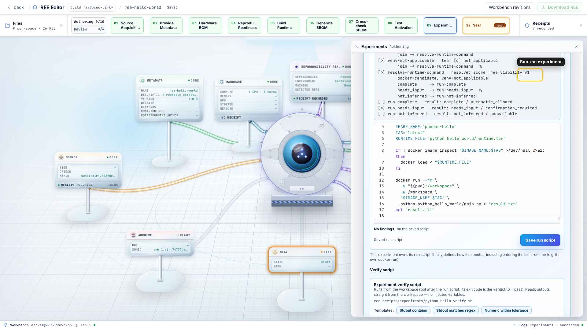

# Experiments in an REE

An experiment has a run script that produces a result and, optionally, a verify
script that decides whether the result supports the declared claim.

This guide follows [The runtime of an REE](build-runtimes.md). That guide covers
the environment. This one covers what runs inside it and how the outcome becomes
evidence.

## The experiment contract

Naming an experiment declares it on the REE and fixes its reserved script paths.
For an experiment named `figure-3`, repo2ree uses:

| Part | Path | Purpose |
|---|---|---|
| Run script | `ree-scripts/experiments/figure-3.sh` | Enters the runtime and produces the result. |
| Verify script | `ree-scripts/experiments/figure-3.verify.sh` | Checks the fresh result. Its exit code is the verdict. |
| Output files | Declared workspace paths | Files captured after a successful run. |

Names may contain letters, digits, spaces, `.`, `_`, and `-`. Spaces become
hyphens in the script slug. Use a name for the claim, such as `figure-3` or
`table-2-ablation`, rather than for the mechanism.



The verify script is optional. Without one, repo2ree can record that the command
ran, but a later review cannot decide whether the result reproduced the claim.

## Generate the run scaffold

After you declare an experiment and build the runtime, select **Generate from
repository**. repo2ree inspects the runtime and fills in the mechanical parts:

- the runtime artifact path;
- the Docker image reference or virtualenv restore path;
- the workspace mount and working directory;
- a reserved log path for captured stdout.

It does not choose the scientific command. The generated script contains an
empty `set --` and exits 64 until you fill it in. This fail-closed behavior
prevents an inferred command from becoming evidence by accident.

For a Docker runtime, replace the empty line with the command and its arguments:

```sh
# Generated scaffold excerpt
set -- python python_hello_world/main.py
```

Keep the generated loading and output-capture code unless the experiment needs
different behavior. The generated scaffold redirects stdout to a file and then
prints that file:

```sh
docker run --rm \
    -v "$(pwd):/workspace" \
    -w /workspace \
    "$IMAGE_TAG" \
    "$@" \
    >"$RUN_LOG"

cat "$RUN_LOG"
```

Do not replace the redirect with `| tee`. A POSIX pipeline reports the status of
its last command, so `tee` can hide a failed experiment. Redirecting preserves
the experiment command's exit status.

The run script executes as `sh <path>` from the workspace root. repo2ree does
not inject environment variables or capture stdout for the verify script. If a
check needs stdout, the run script must write it to a declared workspace file.

## Write the verify script

The verify script runs from the workspace root after the run script. A zero exit
code means the declared check passed; any other code means it failed.

The editor provides templates for common checks:

| Template | Claim |
|---|---|
| Stdout contains | The run log contains an expected phrase. |
| Stdout matches regex | The run log matches an extended regular expression. |
| Numeric within tolerance | An extracted number is within an allowed tolerance. |
| Output file SHA-256 | A file has the recorded digest. |

Templates contain `EDIT-ME` values. An unedited template fails instead of
passing without a real check. A simple fixed-text check looks like this:

```sh
#!/usr/bin/env sh
set -eu

EXPECTED="Pandas Hello World"
grep -Fq "$EXPECTED" "results/python-hello.log"
```

### Choose a scientifically meaningful check

Byte-for-byte equality is often too strict. Timestamps, hostnames, and floating-
point operation order can change without changing the result. Choose the least
strict check that still rejects a wrong result:

- use a digest when every byte must match;
- use a tolerance for numeric metrics;
- check schema, row counts, or key values for tabular data;
- use a statistical test for a distributional claim.

Because the criterion is a script, a reviewer can inspect it and challenge it.
That is stronger than asking the reviewer to judge a figure by eye.

## Declare output files

Declare every file that the run produces and that matters to the claim. After a
successful run, repo2ree copies those paths into the experiment's result store
and records their digests.

The **Seal** page has one option to include experiment results. When selected,
the bundle stores captured author baselines under
`ree/results/<experiment>/`. This is a bundle-wide choice, not an option on each
experiment.

The baseline is comparison evidence. The verify script must always read the
fresh files in the workspace. A check that reads `ree/results/<experiment>/`
would only test the author's old result and could pass without reproducing
anything.

## What the verdicts mean

An author **validates** a run when the run and verification scripts exit zero.
This is not yet a reproduction. Reproduction requires a later, independent run
and a comparison with the author's evidence.

| Verdict | Meaning |
|---|---|
| `inconclusive` | The comparison lacks a verify script, a valid author baseline, or the same verification criterion. |
| `different` | The author's criterion failed on the reviewer's fresh outputs. |
| `reproduced` | The author's criterion passed on the reviewer's fresh outputs. |
| `identical` | The criterion passed and both output digests match. |

A changed verify-script digest makes the comparison inconclusive because it is a
different test. A changed output digest does not override a passing criterion:
two valid results can differ in irrelevant bytes.

## Design experiments that survive

- **Keep one claim per experiment.** Split a script that produces many unrelated
  results so a failure identifies the affected claim.
- **Control randomness.** Seed every generator and record any remaining
  nondeterminism.
- **Fetch nothing at run time.** Put stable inputs in the source or runtime, or
  document and declare them separately.
- **Offer a short check.** A smoke test helps reviewers diagnose the setup before
  they start an expensive experiment.
- **Write only to declared paths.** Undeclared outputs are not captured or
  compared.
- **Make experiments independent.** The standalone `run.sh all` uses one clean
  materialization for the sequence. A reviewer may also run one experiment by
  itself, so never depend on leftovers from another experiment.

## Common mistakes

- A check such as `grep ... || true` cannot fail and proves nothing.
- A verify script cannot inspect stdout unless the run script saved it.
- `| tee` can replace the experiment's failure code with `tee`'s success code.
- A verify script must read fresh workspace output, not the sealed baseline.
- A container running as root may create workspace files the host user cannot
  remove.
- A generated scaffold still containing `set --` exits 64 by design.
- Script and output paths must remain inside the workspace.
