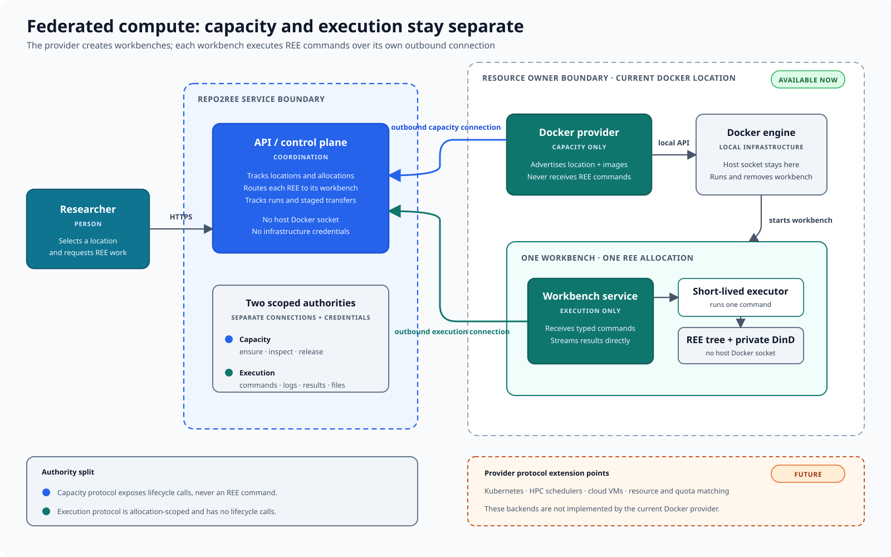

# Federated compute through connected providers

repo2ree can coordinate execution on infrastructure operated by a user,
laboratory, or institution without moving that infrastructure's credentials
into the hosted service. A resource owner runs a **provider** beside its compute.
The provider offers a named location to repo2ree and manages workbench capacity
there.

The provider does not execute REE operations. Each provisioned **workbench**
connects to the control plane separately and executes commands for one REE.
Keeping capacity and execution on different connections is the defining boundary
of the current design.

## One location, two connections

The compute side has two deployables with different authority:

| Connection | What connects | What it can do | What it cannot do |
|---|---|---|---|
| **Capacity** | Provider → control plane | Register a location and its workbench-image catalog; ensure, inspect, and release allocations through the local Docker engine. | Receive or execute an REE command. |
| **Execution** | Workbench → control plane | Enroll against one allocation; receive typed REE commands; stream ordered logs, results, and file transfers. | Create or remove infrastructure. |

Both connections originate from the compute side. A site therefore does not
need to expose a provider or workbench listener to the public network. The
control plane accepts the connections and uses a different credential for each
authority.

## How an allocation becomes a workbench

1. A provider connects to the control plane and advertises its location and
   available workbench images.
2. An author selects that location and a base image.
3. The control plane reserves a workbench identity and sends the provider an
   allocation request with a single-use enrollment token.
4. The provider uses its local Docker socket to create the workbench container
   and durable volumes, inject the versioned executor and tools, and start the
   workbench service.
5. The workbench uses the enrollment token to open its own outbound execution
   connection. The control plane binds that connection to the allocation.
6. REE commands now travel directly between the control plane and the
   workbench. The provider is not in the command, log, result, or file-transfer
   path.
7. When the author releases the workbench, the control plane asks the provider
   to remove the allocation.

The protocols do not accept one credential in place of the other. This prevents
accidental authority crossover: capacity requests contain no REE command, and
the execution protocol contains no infrastructure-lifecycle operation. The
provider host remains trusted because it receives enrollment material and
creates the workbenches for its allocations.

## Where credentials and data stay

The control plane knows the location, allocation, routing, and run state. It
does not receive the resource owner's container-runtime socket or host
credentials.

The provider holds the local Docker socket, but it does not receive the REE's
commands. The workbench holds the REE tree and executes the author's scripts,
but in the default Docker-in-Docker mode it does not receive the host Docker
socket. Logs, results, and requested file transfers leave the workbench through
its execution connection; infrastructure credentials do not.

This boundary lets a site keep source or data near its own compute while using
a shared repo2ree control plane. Resource owners still decide whether to run a
provider, which workbench images to offer, and when to revoke its access.

## Current support and extension points

**Available now:** the Docker provider manages workbenches on one Docker host.
It advertises a named location and curated workbench-image catalog. The default
workbench uses a private Docker-in-Docker daemon and a durable per-REE volume.

**Not implemented yet:** Kubernetes, HPC scheduler, and cloud-VM providers;
general CPU, memory, GPU, quota, and policy matching; and VM-backed workbench
isolation. Those are extension points for the provider and allocation protocols,
not capabilities of the current Docker provider.

The present privileged Docker-in-Docker workbench is an operational isolation
boundary, not a VM security boundary. Operators should apply their own trust and
deployment policy to repository code until a hardened runtime is available.

For the internals of each compute-side deployable, continue to
[How workbenches are provisioned and driven](workbench.md). For the path an REE
command takes after enrollment, see
[How a pipeline stage runs](pipeline-stage-execution.md).
